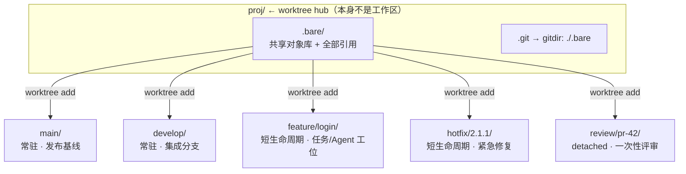

# Git Worktree 工业级实践指南

> 面向：需要同时推进多条任务线的工程师、CI/CD 维护者、以及用多个 AI 编码 Agent 并行开发的团队。
> 本文所有命令均在 **git 2.56.0.windows.2 / Git Bash** 下实机验证过，验证结论见文末「附录 A」。

---

## 1. 一句话结论

`git checkout` 是**单工位**模型：一个工作目录、一个 HEAD、切换分支就得 `stash` 或先清空改动。
`git worktree` 把它变成**多工位**模型：**同一个 `.git` 对象库 + 同一套引用，挂载多个互相独立的工作目录**，每个目录各自绑定一个分支、各自拥有独立的 index 与未提交改动。

工业界最先进的用法不是「偶尔 `git worktree add` 一下」，而是把它当作**仓库的标准拓扑**：

```
bare 对象库作为中枢（hub）+ 每个长期分支/每个并发任务一个常驻或短生命周期 worktree
```

在此之上叠加四类工作流：**并行 AI Agent、线上热修复零上下文切换、PR 评审与 CI 并发构建、长生命周期分支常驻**。

---

## 2. 为什么需要它：四种方案对比

| 方案 | 切换成本 | 对象库 | 并行任务 | 主要问题 |
| --- | --- | --- | --- | --- |
| `git stash` + `checkout` | 高，且易冲突 | 1 份 | 不支持 | stash 易遗忘/丢失；脏工作区无法 CI 复现；上下文切换打断心流 |
| 多次 `git clone` | 低 | **N 份冗余** | 支持 | 磁盘与 fetch 成本翻倍；分支/引用各自独立，同步靠人肉 |
| Docker / 容器里各跑一份 | 中 | N 份 | 支持 | 重，启动慢，本地文件与容器互传麻烦 |
| **`git worktree`** | **近乎为零** | **1 份共享** | **原生支持** | 工作区之间不共享 `node_modules` 等未跟踪产物；worktree 元数据不随 push 传播（见 §8） |

关键差异：worktree 之间**共享对象库与所有 ref**。在某个 worktree 里 `commit` 或 `tag`，其他 worktree 立刻可见，无需 `fetch`、无需 `push`。

---

## 3. 心智模型（读懂这节，后面都不会踩坑）

```
主工作区  proj/                 链接工作区  proj/feature/login/
├── .git/          ← 目录      ├── .git       ← 文件，内容: gitdir: <hub>/.git/worktrees/login
│   ├── objects/   ← 唯一对象库  ├── index      ← 独立
│   ├── refs/      ← 唯一引用集  └── src/       ← 独立工作树
│   └── worktrees/ ← 元数据
│       └── login/{HEAD,gitdir,commondir,locked}
```

- **对象库唯一**：`git rev-parse --git-common-dir` 在所有 worktree 中指向同一个目录。
- **引用唯一**：分支、tag、remote-tracking 引用全局共享；因此**同一个分支不能被两个 worktree 同时 checkout**（git 会拒绝，`--force` 可绕过但危险）。
- **工作树独立**：`.git/index`、未跟踪文件、未提交改动、构建产物、`node_modules` 各自一份。
- **元数据本地**：`worktrees/` 下的管理信息只在本地 `.git` 里，**不会被 commit，也不会被 push**（详见 §8）。
- 链接工作区的 `.git` 是一个**文本文件**而非目录，内容是 `gitdir: ...`；主工作区的 `.git` 是目录。可用这一点快速判断。

---

## 4. 最先进拓扑：bare 中枢 + 常驻 worktree

### 4.1 目录结构



为什么用 **bare 中枢**而不是普通 `git clone`？

1. 普通 clone 的主目录本身就是一个绑定 `main` 的工作区，于是 `main` 被「占用」，你不能再 `git worktree add main main`；所有分支无法被平等对待。
2. bare 中枢**没有任何分支被 checkout**，每个分支都能被干净地 `worktree add`，主目录只是一个纯容器。
3. 在 bare 中枢里执行一次 `git fetch`，所有 worktree 立刻看到最新的 `origin/*`，无需逐目录 `fetch`。
4. CI/构建机上每个 job 挂一个 worktree，天然隔离，不会互相 `git clean`。

### 4.2 推荐配方（已验证）

```bash
# 用 git init --bare 建中枢，而不是 git clone --bare —— 原因见 §4.3
mkdir proj && cd proj
git init --bare .bare
printf 'gitdir: ./.bare\n' > .git          # 让中枢目录本身可被 git 识别
git remote add origin git@github.com:ORG/REPO.git
git fetch origin                           # 生成 origin/* 引用，中枢无 checked-out 分支，fetch 畅通

# 常驻工位（--track 建立 upstream，之后各工位可正常 pull / merge）
git worktree add --track -b main    main    origin/main
git worktree add --track -b develop develop origin/main

# 任务工位
git worktree add -b feature/login feature/login main
git worktree add --detach review/pr-42 main      # 一次性评审，不创建分支

git worktree list
```

本仓库提供可直接执行的版本：[`scripts/setup-bare-worktrees.sh`](../scripts/setup-bare-worktrees.sh) 与 PowerShell 版 [`scripts/setup-bare-worktrees.ps1`](../scripts/setup-bare-worktrees.ps1)。

### 4.3 两个必须知道的坑（本机实测）

**坑 1：中枢目录不是工作区。**
`core.bare = true` 时，在 `proj/` 根目录执行 `git status` 会报：

```
fatal: this operation must be run in a work tree
```

这是**预期行为**。所有工作区操作都要落到具体工位里：

```bash
git -C main status          # ✅
git -C main pull            # ✅
cd main && git status       # ✅
cd proj && git status       # ❌
```

**坑 2：不要 `git config core.bare false`。**
很多教程教你在建好中枢后把 `core.bare` 改成 `false`，想让根目录也能 `git status`。实测后果是：根目录随即变成绑定 `main` 的主工作区，随后 `git worktree add main main` 直接失败：

```
fatal: 'main' is already used by worktree at '.../proj/.bare'
```

保持 `core.bare = true`，接受「中枢只做容器」。

**坑 3：网上广泛流传的 `git clone --bare` 配方有缺陷。**
`git clone --bare` 会把远端分支直接复制成本地 `refs/heads/*`，**既不生成 `remote.origin.fetch`，也不生成 `origin/*` 远程跟踪引用**。于是很多人补上：

```bash
git config remote.origin.fetch '+refs/heads/*:refs/heads/*'
```

但只要分支已被某个 worktree checkout，一次 `git fetch` 就会报：

```
fatal: refusing to fetch into branch 'refs/heads/main' checked out at '.../proj/main'
```

因为 git 拒绝更新任何被 worktree 占用的分支引用。**结论：用 `git init --bare` + 默认 refspec（`+refs/heads/*:refs/remotes/origin/*`）**，让中枢只维护 `origin/*`，各工位自己 `merge --ff-only origin/main` 同步，既安全又符合常规心智模型。

同步流程：

```bash
git fetch origin                          # 在中枢执行一次，所有工位共享新对象与 origin/*
git -C main merge --ff-only origin/main
git -C develop merge --ff-only origin/develop
```

---

## 5. 四类典型工业工作流

### 5.1 并行任务 / 多 AI 编码 Agent（2025–2026 最主流的新用法）

Claude Code、CodeBuddy、Cursor 等工具的 background/并行 Agent 模式，底层几乎都用 worktree：**每个 Agent 一个独立目录 + 一个独立分支**，避免多个 Agent 同时改同一批文件造成互相覆盖。

```bash
# 编排层：为每个任务分配工位
for i in 1 2 3; do
  git worktree add -b "agent/task-$i" "agents/task-$i" main
done
# 把 agents/task-1、agents/task-2、agents/task-3 分别交给 3 个 Agent
# 每个 Agent 在自己的目录里写码、跑测试、commit，互不感知
git -C agents/task-1 log --oneline -3     # 收集结果
git -C main merge --ff-only agent/task-1   # 逐个评审合入
git worktree remove agents/task-1 && git branch -d agent/task-1
```

要点：

- 用 `-b` 给每个 Agent 独立分支；**不要**让两个 worktree 指向同一分支。
- Agent 提交后，主工作区**无需 fetch** 即可 `merge` —— 对象库是共享的。
- 用 `git worktree list --porcelain` 给编排脚本提供机器可读的工位清单。
- 临时验证用 `--detach`，不污染分支命名空间。

### 5.2 线上热修复：零上下文切换

你正在 `feature/pay` 上改到一半、工作区一堆未提交改动，线上 P0 告警进来。传统做法 `stash → checkout main → 修 → 切回 → stash pop`，风险高。worktree 做法：

```bash
# 从当前 main 基线拉出一个独立工位，主工作区完全不动
git worktree add -b hotfix/2.1.1 ../hotfix/2.1.1 origin/main

cd ../hotfix/2.1.1
# 修 → 跑测试 → commit → 打 tag → push
git commit -am "hotfix: 修复支付回调空指针"
git tag v2.1.1
git push origin hotfix/2.1.1 v2.1.1

# 在主工作区（或发布工位）合入，全程没有 checkout / stash
cd -
git merge --ff-only hotfix/2.1.1

git worktree remove ../hotfix/2.1.1
git branch -d hotfix/2.1.1
```

收益：**热修复与进行中的特性开发物理隔离**，上下文零丢失，且热修复工位可直接对接发布流水线。

### 5.3 PR 评审与 CI 并发构建

**PR 评审**：给每个待审 PR 一个 detached 工位，评审完即删，不产生垃圾分支。

```bash
git worktree add --detach ../review/pr-42 origin/main
cd ../review/pr-42
gh pr checkout 42            # 在该工位内检出 PR，不影响其他工位
# 跑测试、看 diff
cd -
git worktree remove ../review/pr-42
```

**CI 并发构建**：同一份对象库上，矩阵里的每个 job 挂一个 worktree，避免多个 job 共享工作目录导致 `git clean` 竞态。

```bash
# 每个 job 开头
WORKTREE="$(mktemp -d)"
git worktree add --detach "$WORKTREE" "$CI_COMMIT_SHA"
trap 'git worktree remove --force "$WORKTREE"; git worktree prune' EXIT
cd "$WORKTREE"
# build / test ...
```

`--detach` + `trap` 是 CI 里的标准组合：不占分支、异常退出也能清理。

### 5.4 长生命周期分支常驻

`main` / `develop` / `release/*` 各占一个**从不删除**的工位，永远不在中枢里 `checkout`。好处：

- 任何时候 `git -C release/2.1 status` 都能看到发布分支真实状态；
- 对比、cherry-pick、打 tag 不需要切换；
- 配合 `git worktree lock` 防止被误清理。

---

## 6. 命令速查（按生命周期）

| 阶段 | 命令 | 说明 |
| --- | --- | --- |
| 创建 | `git worktree add <path> <commit-ish>` | 检出已有分支 |
| 创建 | `git worktree add -b <branch> <path> <base>` | 新建分支并检出（最常用） |
| 创建 | `git worktree add --track -b <branch> <path> origin/<branch>` | 建立 upstream 跟踪 |
| 创建 | `git worktree add --detach <path> <commit-ish>` | 分离 HEAD，用于评审/CI |
| 创建 | `git worktree add --lock --reason "<原因>" ...` | 创建即锁定，禁止 prune |
| 查看 | `git worktree list` / `list -v` / `list --porcelain` | `-v` 显示 locked/prunable；`--porcelain` 给脚本用 |
| 锁定 | `git worktree lock --reason "<原因>" <path>` / `unlock <path>` | 保护移动磁盘/网络盘上的工位，防 `prune` |
| 移动 | `git worktree move <worktree> <new-path>` | 由 git 同步更新元数据，**优先用它而不是 `mv`** |
| 修复 | `git worktree repair [<path>...]` | 手工 `mv` 过目录后修复失联的 gitdir 指针 |
| 清理 | `git worktree remove [-f] <path>` | 正确删除方式；有改动需 `-f` |
| 清理 | `git worktree prune [-n] [-v] [--expire <time>]` | 清除已失效（目录被手动删）的元数据，`-n` 预演 |
| 跨工位 | `git -C <path> <cmd>` | 不 `cd` 直接操作指定工位，脚本必备 |

> 提示：`git worktree add --relative-paths`（git 新版）可让元数据记录相对路径，便于整棵目录树搬迁。

---

## 7. 团队治理规范（把 worktree 用成制度而非技巧）

1. **统一中枢拓扑**：团队/CI 一律用 §4.2 的 bare 中枢脚本初始化，避免每人一套目录约定。
2. **命名约定**：`main/`、`develop/` 常驻；`feature/<ticket>/`、`hotfix/<version>/`、`review/pr-<n>/`、`agents/<task>/` 短生命周期。
3. **短生命周期强制回收**：合并后 PR 流水线里执行 `git worktree remove` + `git branch -d` + `git worktree prune`，否则 `.git/worktrees/` 会持续膨胀。
4. **CI 必带 `trap`**：detached 工位 + 退出钩子清理，保证异常构建不残留。
5. **常驻工位上锁**：`git worktree lock --reason "release baseline"`，防止有人跑 `prune` 误删。
6. **禁止手工删目录**：直接 `rm -rf` 工位目录会留下陈旧元数据，必须用 `git worktree remove`；已经误删就用 `git worktree prune` / `repair` 补救。
7. **禁止 `--force` 复用同一分支**：两个 worktree 同时 checkout 一个分支会让其中一个的 index 与 HEAD 不一致，属于事故级操作。
8. **依赖产物不共享**：`node_modules`、`.venv`、`target/` 各工位一份。用 pnpm store / 共享缓存 / 符号链接降低磁盘开销，别指望 worktree 帮你省这部分。
9. **子模块各自更新**：每个工位需单独 `git submodule update --init --recursive`；hooks 则共享同一份 `hooks/`（注意 `core.hooksPath`）。
10. **中枢只放容器**：不要把源码放在中枢根目录，`core.bare` 保持 `true`（见 §4.3）。

---

## 8. 最容易被忽略的一条：worktree 元数据不会随 push 传播

`git worktree` 创建的是**本地管理数据**，存放在主工作区 `.git/worktrees/` 下，它不属于版本库内容：

- 不进 `git add`，不进 commit；
- `git clone` / `git pull` / `git push` **都不会携带**；
- 同事 clone 你的仓库、CI 拉起新机器后，看到的是**一个干净的单工作区**。

因此必须区分两类产物：

| 产物 | 是否随 push 传播 | 团队如何对齐 |
| --- | --- | --- |
| 分支、tag、commit | ✅ 是 | 正常 push |
| worktree 目录与 `.git/worktrees/` 元数据 | ❌ 否 | 用**初始化脚本**（本仓库 `scripts/`）或 CI step 重建 |
| 目录拓扑约定、命名规范 | ❌ 否 | 写进本文档 / CODEBUDDY.md / 开发手册 |

**实践结论**：把拓扑搭建脚本化并提交进仓库，是 worktree 能落地为团队规范的前提。本仓库正是这么做的——`docs/` 负责说明，`scripts/` 负责在任何一台新机器上重建同一套拓扑。

---

## 9. 什么时候不该用 worktree

- 需要**对象库级别隔离**（不同权限、不同 LFS 配置、安全沙箱）→ 用独立 clone 或容器。
- 仓库超大且依赖产物极重（`node_modules` 数十 GB）、磁盘紧张 → N 个工位 = N 份未跟踪产物，反而更贵；可配合 `sparse-checkout` 或共享缓存。
- 只是想看一眼某个历史版本 → `git show` / `git archive` 更轻。
- 需要同时修改**同一个分支**的两处互不相关的改动 → 拆成两个分支 + 两个工位，或直接用 `git add -p` 分次提交。

---

## 10. 本仓库的实机演示

本仓库本身就是一次可复现的演示，顶层结构：

```
test_git_worktree/
├── .gitignore
├── README.md
├── docs/git-worktree-industrial-guide.md   ← 本文
├── scripts/
│   ├── demo-worktree.sh                    ← 一键复现下方全部流程
│   ├── setup-bare-worktrees.sh             ← bare 中枢初始化（Bash）
│   └── setup-bare-worktrees.ps1            ← bare 中枢初始化（PowerShell）
└── src/app.py                              ← 最小示例，让各分支有真实 diff
```

在仓库根目录执行：

```bash
bash scripts/demo-worktree.sh
```

脚本按顺序演示并打印结果：

1. `git worktree add -b develop ...` —— 常驻集成分支工位；
2. `feature/parallel-agents`、`feature/billing` —— 两个并行任务/Agent 工位，各自独立提交；
3. 打印 `rev-parse --git-common-dir`，验证**所有工位共享同一对象库**；
4. `hotfix/1.0.1` —— 线上热修复工位，改版本号、commit、打 `v1.0.1` tag；随后**在主工作区** `git merge --ff-only hotfix/1.0.1` 完成合入，主工作区自始至终没有 `checkout`、没有 `stash`；
5. `git worktree add --detach` —— 一次性 PR 评审工位；
6. `git worktree list -v`、`lock`/`unlock` —— 巡检与锁定；
7. `git worktree remove` + `git worktree prune` —— 规范回收。

演示结束后远端会保留 `main`、`develop`、`feature/parallel-agents`、`feature/billing`、`hotfix/1.0.1` 与 `v1.0.1`，直观呈现「一条基线 + 多条并行线」的拓扑。

仓库地址：<https://github.com/edidada/test_git_worktree>

---

## 附录 A：本机验证记录

环境：Windows 11 / Git Bash / `git version 2.56.0.windows.2`。以下结论均为实测，非文档推断。

| # | 验证项 | 实测结果 |
| --- | --- | --- |
| 1 | `git clone --bare` + `.git` gitdir 文件 + `git worktree add main main` | ✅ 成功，`core.bare = true` |
| 2 | 在中枢根目录执行 `git status` | ❌ `fatal: this operation must be run in a work tree`（预期） |
| 3 | 改为 `git config core.bare false` 后再 `worktree add main main` | ❌ `fatal: 'main' is already used by worktree at '.../.bare'` |
| 4 | `git clone --bare` 是否生成 `remote.origin.fetch` | ❌ 不生成，也不生成 `origin/*` 引用 |
| 5 | `git clone --bare` + `+refs/heads/*:refs/heads/*` 后 `git fetch`（分支已被 checkout） | ❌ `fatal: refusing to fetch into branch 'refs/heads/main' checked out at ...` |
| 6 | `git init --bare` + 默认 refspec `+refs/heads/*:refs/remotes/origin/*` + `git fetch` | ✅ 生成 `origin/main`、`origin/HEAD` |
| 7 | `git worktree add --track -b main main origin/main` | ✅ 成功，upstream 正确建立 |
| 8 | 中枢执行一次 `fetch`，再 `git -C main merge --ff-only origin/main` | ✅ 工位同步到最新提交 |
| 9 | `git worktree add --detach` / `lock` / `remove` / `prune` | ✅ 均可用 |

`git worktree` 支持的子命令与参数（本机 `-h` 输出）：

```
git worktree add [-f] [--detach] [--checkout] [--lock [--reason <string>]]
                 [--orphan] [(-b | -B) <new-branch>] <path> [<commit-ish>]
git worktree list [-v | --porcelain [-z]]
git worktree lock [--reason <string>] <worktree>
git worktree move <worktree> <new-path>
git worktree prune [-n] [-v] [--expire <expire>]
git worktree remove [-f] <worktree>
git worktree repair [<path>...]
git worktree unlock <worktree>
```
